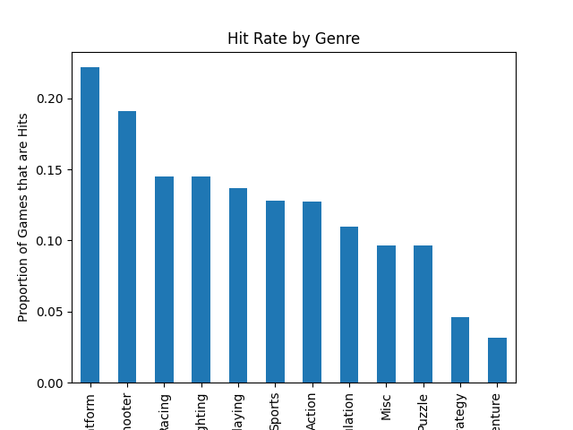

# Video Game Sales: Hit Prediction

## Question

Can a game's platform, genre and publisher predict whether it becomes a "hit" (sells over 1 million copies globally)?

## Data

Kaggle "Video Game Sales" dataset: about 16,500 games with platform, genre, publisher, year, and regional/global sales figures. Rows with missing values were dropped before modelling.

## Approach

1. Dropped rows with missing values (`dropna()`).
2. Created a binary target: `is_hit = 1` if `Global_Sales > 1.0` (million copies), else `0`.
3. One-hot encoded `Platform` and `Genre` with `pd.get_dummies`.
4. Split the data 80/20 into train and test sets (`random_state=42`).
5. Trained and compared three models:
   - Decision Tree (`max_depth=5`)
   - Random Forest (`n_estimators=100`, `max_depth=5`)
   - Logistic Regression (`max_iter=1000`)
6. Repeated the experiment after adding `Publisher` as a feature, grouping it into the 10 largest publishers plus "Other".
7. Inspected the decision tree's feature importances.

## Results

About 87.5% of games in the dataset are **not** hits, so a model that always predicts "not hit" already scores about 87.5% without learning anything. All results should be read against that baseline.

| Model | Platform + Genre | + Publisher |
|---|---|---|
| Decision Tree | 88.77% | 88.68% |
| Random Forest | 88.37% | 88.49% |
| Logistic Regression | 88.74% | 88.77% |
| *Majority-class baseline* | *about 87.5%* | *about 87.5%* |

### Most important features (Decision Tree with publisher)

| Feature | Importance |
|---|---|
| Publisher: Nintendo | 0.474 |
| Publisher: Electronic Arts | 0.137 |
| Platform: NES | 0.098 |
| Publisher: Sony Computer Entertainment | 0.051 |
| Platform: PS4 | 0.041 |



## Key Findings

- The best models reach about 88.8% accuracy, only about 1.2 percentage points above the always-"not hit" baseline.
- Model choice barely matters: the three models are within about 0.4 points of each other. The Random Forest did not beat the single decision tree, which suggests the limit comes from the features, not the model.
- Adding publisher information did not meaningfully improve accuracy (Decision Tree: 88.77% to 88.68%).
- Nintendo has the highest feature importance (47.4%) in the tree. This shows the model relies on it heavily, not that Nintendo causes hits. Feature importance describes how the model splits the data, not causation.

## Limitations

- **Accuracy is a weak metric here** because the classes are imbalanced. Precision, recall and F1 for the "hit" class would show how many real hits the model actually finds.
- Results come from a single train/test split, with no cross-validation.
- `dropna()` discards rows, which may bias the data.
- The top-10 publisher grouping was chosen arbitrarily.
- The dataset has no budget, marketing or review-score information, which likely matter more than platform and genre.

## What I'd try next

- Report a confusion matrix and per-class precision, recall and F1.
- Add `Year` to capture market growth over time.
- Use cross-validation for more reliable comparisons.
- Try class weighting or resampling to handle the imbalance.

## How to run

```bash
pip install pandas scikit-learn jupyter
jupyter notebook video_game_sales_analysis.ipynb
```

Make sure `vgsales.csv` is in the same folder as the notebook.

## Tools

Python, pandas, scikit-learn
